# moex-data-model: Air-gap deploy

## Исходные факты (из разведки)

- Эталон: [moex-prodata-platform](../moex-prodata-platform) — `ADR-0044-airgap-image-deploy.md`, `scripts/pack-docker-images.ps1`, `scripts/airgap_overlay.py`, `scripts/apply-contour.sh`, `docker/docker-compose.prod.yml` (образы по `${PRODATA_TAG}`, `build: !reset null`). Схема: Full (`docker save` + sha256 + manifest) → Overlay (zip кода, `docker build FROM` загруженного Full) → Contour (один zip: артефакт + release-bundle + `APPLY.md` + `apply-contour.sh`), `deps_fingerprint`, patch-bump, `airgap-state.json`, откат по тегу.
- В `moex-data-model` сейчас нет ни Dockerfile для api/web, ни compose, ни CI. Есть только [apps/drawdb/Dockerfile](apps/drawdb/Dockerfile) (вне объёма).
- API ищет «корень репозитория» по файлу `model-assets/specifications/moex-dams/0.1/schemas/moex-dams.yaml` (`find_repo_root` в `apps/cli/src/moex_model_cli/bootstrap.py`) и работает с моделями как с файлами рабочей копии. Хост/порт зашиты в [apps/api/src/moex_model_api/__main__.py](apps/api/src/moex_model_api/__main__.py) (`127.0.0.1:8000`).
- Хранилище Git: [packages/git-adapter/src/moex_git/factory.py](packages/git-adapter/src/moex_git/factory.py) знает только `local|github`. GitLab-провайдера нет.
- Авторизация: [apps/api/src/moex_model_api/auth.py](apps/api/src/moex_model_api/auth.py) — dev-заглушка (`X-Moex-Actor`, по умолчанию `dev`).
- БД: `MOEX_DATABASE_URL`, по умолчанию SQLite in-memory; `psycopg` в зависимостях есть.
- Версии: корневой `pyproject.toml` — маркер workspace (`0.1.0`); ADR сейчас доходят до ADR-057, значит новый — ADR-058.

## Решения (по ответам пользователя)

- Модели лежат в локальном GitLab, **не в образе**. На сервере — клон в volume `/models` (раскладка репозитория сохраняется: `model-assets/`, `generated/`, чтобы `find_repo_root` и относительные пути в YAML не ломались). Образ содержит только код (`apps/`, `packages/`, `generated/contracts`) и собранный фронтенд.
- В образ входят: api (+cli, пакеты), web (nginx + собранный SPA, прокси `/api` → api), viewer (собирает статическую публикацию из `/models` после каждой синхронизации). drawDB в этот заход не входит.
- Доставка обновлений кода — как в prodata (Full / Overlay / Contour). Доставка обновлений моделей — не через образ, а через `git pull` из GitLab (GitLab локальный и доступен серверу).
- Правки моделей из UI идут через новый `GitLabGitProvider`: ветка + коммит + merge request по GitLab API v4.

```mermaid
flowchart LR
    devMachine[DevMachine_with_network] -->|"pack-docker-images.ps1 -Contour"| contourZip[contour_zip]
    contourZip -->|"USB or share"| prodHost[ProdServer]
    prodHost --> applyScript[apply-contour.sh]
    applyScript --> modelApi[model-api]
    applyScript --> modelWeb[model-web_nginx]
    localGitlab[LocalGitLab_models_repo] -->|"git fetch ff-only"| modelsSync[models-sync]
    modelsSync --> modelsVolume[models_volume]
    modelsVolume --> modelApi
    modelsVolume --> viewerBuild[viewer_build]
    viewerBuild --> modelWeb
    modelApi -->|"branch + MR via REST"| localGitlab
```

## Серия PR (по правилу multi-pr-series: один PR — одна тема, схемы/данные не смешиваем)

### PR-0. ADR-058 и описание в docs/user (без кода)
- `docs/adr/ADR-058-airgap-image-deploy.md`: Full/Overlay/Contour, граница «код в образе / модели в GitLab», `deps_fingerprint`, правила версий, отклонённые альтернативы (git-pull на сервере, registry как обязательный канал, модели внутри образа). Явно записать: нормы prodata ADR-0044 берём как прецедент, а не как зависимость.
- Строка в `docs/adr/README.md` (индекс 001–058).
- По `.cursor/rules/user-docs.mdc`: страница `docs/user/30-howto/deploy-airgap.md` с `draft: true`, поле `sources` включает ADR-058; термины (Full, Overlay, Contour-drop, deps_fingerprint) — в `docs/user/glossary.yaml`; запись в `toc.yaml`; `make user-docs` для пересборки `docs/user/index.html`.
- Не трогать `schemas/` и `generated/`.

### PR-1. Контейнерная готовность api (малый код)
- `__main__.py`: `MOEX_API_HOST` / `MOEX_API_PORT` (по умолчанию как сейчас).
- `auth.py`: режим доверенного заголовка (`MOEX_AUTH_MODE=trusted-header`, nginx передаёт имя пользователя); dev-режим остаётся по умолчанию. Риск зафиксировать в ADR: пока нет OIDC, доступ закрывают на уровне сети/nginx.
- Эндпоинт/команда preflight «модели совместимы с образом»: наличие marker-файла и сверка `generated/manifests/moex-dams-contracts.json` клона с контрактами в образе (аналог `runtime-deps` в prodata).
- Тесты в `apps/api/tests`.

### PR-2. GitLabGitProvider
- `packages/git-adapter/src/moex_git/gitlab.py` по образцу `github.py` (`httpx`): `get_file`, `resolve_revision`, `list_revisions`, `create_branch`, `commit_files` (commits API с `actions`), `create_review` (merge request).
- `factory.py`: ветка `gitlab`; env `MOEX_GITLAB_URL`, `MOEX_GITLAB_PROJECT`, `MOEX_GITLAB_TOKEN`, `MOEX_GITLAB_BASE`; поддержка `MOEX_GITLAB_CA_BUNDLE` для внутреннего TLS.
- Тесты на `httpx.MockTransport` (как у GitHub-провайдера), без сети.

### PR-3. Образы и compose (без air-gap-логики)
- `docker/api.Dockerfile`: python:3.11-slim, `pip install -e` apps/api, apps/cli, packages/*, generated/contracts (editable — это условие для Overlay), non-root пользователь, LABEL `moexmodel.deps_fingerprint|full_version|git_sha`.
- `docker/web.Dockerfile`: multi-stage `node:20-alpine` (`npm ci && npm run build` в `apps/web`) → `nginx:alpine`, конфиг `/api` → `model-api:8000`, `/viewer/` → статика публикации из volume.
- `docker/models-sync.sh` (в api-образе): `git clone/fetch --ff-only` из GitLab по read-only deploy token, затем `moex-publication-viewer build --root /models`; запуск при старте и по таймеру.
- `docker-compose.yml` (сервисы `model-api`, `model-web`, `models-sync`; volumes `models`, `data`; SQLite-файл по умолчанию, PostgreSQL — через `MOEX_DATABASE_URL`) и `docker/docker-compose.prod.yml` с `image: ...:${MODEL_TAG}` и `build: !reset null` (первый `-f` всегда `docker-compose.yml`, как в prodata).
- `.dockerignore` (без `.env`, `.venv`, `tmp`, `model-assets` — модели не едут в образ), `.env.example`.
- Проверка: локальный `docker compose up`, `/health`, открытие UI, правка модели → ветка/MR в тестовом GitLab-проекте.

### PR-4. Механизм доставки (копия подхода prodata)
- `scripts/airgap_overlay.py`: `fingerprint`, `stage`, `bump-patch`, `gate-clean`, `gate-version`, `write-apply-md`, `assemble-contour`, `zip-tree` (POSIX-пути в zip).
  - `deps_fingerprint` = Dockerfiles + срезы зависимостей всех `pyproject.toml` (без `version`) + hash `apps/web/package-lock.json`; sibling-репозиториев нет.
  - Overlay-снимок: `apps/*/src`, `packages/*/src`, `generated/contracts`, prebuilt `apps/web/dist`; `rm -rf` + COPY поверх Full-родителя, `docker build --network=none`.
- `scripts/pack-docker-images.ps1` (`-Mode Full|Overlay`, `-Contour`, `-ParentTag`, `-KeepLast`, `-OutDir reports/docker`): сборка, smoke, `docker save | gzip`, sha256, manifest, release-bundle (compose, prod-compose, `.env.example`, deploy-конфиги), retention.
- `scripts/apply-contour.sh` + `apply-overlay.sh`: sha256, `unzip`, `docker load` / overlay-build, запись `MODEL_TAG` в `.env`, `airgap-state.json`, `docker compose up -d`, откат через `APPLY_ALLOW_DOWNGRADE=1` или ручной `MODEL_TAG`.
- Версия релиза: поле `version` корневого `pyproject.toml` (patch-bump на каждый Contour, коммит bump отдельно).
- Makefile-цели (`pack-full`, `pack-contour`) и фразы для них в `docs/user/90-reference/descriptions.yaml`; обновить `docs/user/30-howto/deploy-airgap.md`; пересобрать `docs/user/index.html`.
- Тесты в `tests/` по образцу `test_airgap_overlay.py` / `test_airgap_pack.py` из prodata (fingerprint, gate-clean, version reuse, состав drop, запрет `grafana/prometheus/nginx` в drop при необходимости).

### PR-5. Работа с локальным GitLab (операционный слой)
- Runbook в `docs/user/30-howto`: проект моделей в GitLab, protected `main`, deploy token (read_repository) для `models-sync`, project access token (api, scope на MR) для API, правила ревью MR (ADR-012), первичная установка, обновление, откат, чтение LABEL/`airgap-state.json`.
- `.gitlab-ci.yml` для проверки моделей в MR (`make check`) — только если на локальном GitLab есть runner с нужным образом; иначе пункт остаётся в «не рассказано» в `toc.yaml`.

## Риски и допущения

- Версия схемы DAMS в клоне моделей и в образе должна совпадать — иначе API может работать некорректно. Поэтому preflight из PR-1 и запись совместимости в manifest PR-4.
- Базовые образы (`python:3.11-slim`, `node`, `nginx`) нужны только на машине упаковки; на сервере всё внутри `docker save`.
- Проверка по каждому PR отдельно (не только финальный `make check`), как требует `multi-pr-series.mdc`; для PR-0 и PR-4 — `make check` включает `check-user-docs`.
- Новый ADR-058 и PR-3/4 нужно вести ветками `docs/…-pr0-…`, `feat/…-prN-…`; монолитом не отдавать.
