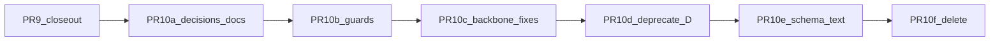

# Requirements backbone: план после аудита

## Состояние серии

- Влито в `main`: PR-0 (#56), PR-1 (#57), PR-2 (#60), PR-3 (#59), PR-4/5/6 (#61), PR-7a..f (#62), PR-8 (#63).
- Открыто: PR-9a (#64, viewer скрывает неактивные требования), PR-9b (#65, группа C → `deprecated`, INV-065..067). Ветка PR-9b стоит поверх PR-9a.
- Каталоги сейчас: `it-solution` 63 строки, `conceptual` 11 строк (итого 74). Активны 17 строк хребта, группа B (2) и группа D (10). Группа A — `superseded`, группа C — `deprecated`.

## Итоги аудита

Что сделано хорошо: окно депрекации соблюдено (PR-2 до PR-5), схема и данные разведены по коммитам (PR-7b/7f, PR-8), группа C получила «дом» в INV до депрекации, решения PR-7/PR-8 записаны в ADR-056 D5.

Найденные проблемы:

1. **Счёт правил.** Правил 17, а не 21 (2 CDM + 13 LDM + 2 PDM). Число 21 стоит в ADR-056 (строки 26, 40, 57, 134), в inventory и в прежней версии плана. Данные верны: в каталогах ровно 17 строк хребта.
2. **Двойное срабатывание.** `GEN-004.c1` (группа D, `approved`) и `PDM-02.c1` исполняют один шаблон (`data_carrying_entity_mapping_or_technical` = `pdm003_entity_physical`). Сейчас нарушений нет, но при первом нарушении будет две ошибки с разными кодами.
3. **LDM-06 не соответствует нормативу.** Проверка — бывший `ldm004_identity`: требует текст `identity_rule` и пропускает сущность с одним `business_key_kind` без `key_attribute_refs`. Норматив требует состав атрибутов идентификатора. Замер: у всех 24 нетехнических сущностей в 4 моделях `key_attribute_refs` заполнен, у всех 24 ключ `surrogate`.
4. **CDM-01/02 не исполняются.** Раннер читает только `it-solution` каталог и возвращает пусто для enterprise-пакетов; `_definition_lints` на КМД не запускается. `CDM-01.c1` (`slot_required description`) — мёртвая проверка, к тому же противоречит ADR-025 (определение может наследоваться). Замер КМД: 82/82 сущностей с описанием, 104/104 связей с `relationship_kind` и `relation_term_ref`, «разновидность» выражена через `parent_concept_ref` (4). Включение проверок ничего не сломает.
5. **Тихий отказ в PR-5.** `entity_type` и `business_importance` перестали проверяться в PR-5 (строка `LDM-003` стала `superseded`, слоты в схеме необязательны). ADR-056 D5 называет это «отложенным решением PR-10», а фактически оно уже действует. Нужно зафиксировать, а не решать заново.
6. **PDM-01:** `obligation: mandatory`, но проверка `warning`. Противоречит ADR-056 D1 (mandatory → `error`).
7. **Скрытый долг LDM-07.** Во всех 4 решениях 31 из 31 связи без `relationship_kind`. Ошибок нет только потому, что все связи `draft`. При переводе моделей в `active` будет 31 ошибка.
8. **Политика диагностических кодов уже выбрана де-факто.** Строки хребта выдают старые коды (`LDM-01` → `DAMS-REQ-GEN-002.c1`), а `LDM-12` — новый (`DAMS-REQ-LDM-12.c1`). ADR-056 D5 при этом планирует переименовать `DAMS-REQ-PDM-009.c3` → `DAMS-INV-034`. Нужно одно правило.
9. **34 `requirement_refs` в матрице никто не валидирует** (`constraint_matrix.py` только рендерит их). После удаления строк они молча станут висячими.
10. **Гигиена PR-9.** `b1818f7` (fix api / publish-gate) не относится к теме PR-9a. В PR-9b коммиты `c4054f7` и `2f1a0f1` не зелёные сами по себе: валидаторы INV-065..067 подключены к L2 только в `754b525`.
11. **План не сохранён в workspace.** ADR-056 ссылается на `.cursor/plans/...` в репозитории, но такой папки нет. Статус ADR — `Proposed`.
12. **LDM-02 проверяет только наличие `api_version`.** Это и так обязательно в схеме, а «актуальная версия спецификации» не проверяется.
13. **Схема ссылается на уходящие коды:** `isolation_rationale` «(LDM-007)» в `moex-core.yaml:700`, `PDM-003` в `moex-core.yaml:340` и `moex-types.yaml:318`.

Замер группы D на 4 моделях решений (crm, esed, mdm, ucd). Удаление уберёт:
- ATR-002: 114 предупреждений;
- ATR-004: 7 предупреждений;
- LDM-008: 2 предупреждения;
- ATR-005: 1 ошибку (esed).

GEN-004, LDM-001, LDM-007, CLS-001, CLS-002, ATR-007 не дают ни одной диагностики.

## PR-9 close-out (до PR-10)

- Вынести `b1818f7` в отдельный PR `fix/api-publish-gate-contracts`, влить первым, затем пересобрать PR-9a/9b без него.
- Влить `754b525` в `c4054f7` как fixup, чтобы каждый коммит PR-9b был зелёным.
- Влить #64, затем #65. Проверка на каждой ветке отдельно: `make validate-requirements`, `make check-constraints`, `make dams-packages-check`, `make check`.

## PR-10: детальный разбор

PR-10 разбит на шесть шагов по образцу PR-7. Сначала документы и безопасные шаги, потом изменения поведения, в конце удаление. Схема (10e) и удаление (10f) не смешиваются, поэтому исключение вида PR-5 не нужно.

### PR-10a. Решения и документы (только docs)

- ADR-056: новый раздел D6 «Решения PR-10» с замерами из аудита, исправить 21 → 17, строки PR-10a..10f в таблице D4, убрать из D5 то, что уже действует (пункт 5 аудита).
- [requirements-inventory.md](docs/migration/requirements-inventory.md): итоговая судьба каждой из 57 строк.
- ADR-013: соглашение о кодах — двузначные `NN` нормативные, трёхзначные `1NN` локальные расширения.
- Сохранить этот план в workspace (Save to Workspace), чтобы ссылка из ADR-056 работала.

Решения по умолчанию, их подтверждаем в PR-10a:

- **Группа D (10):** все в `deprecated` (10d), удаление в 10f. Слоты `context_ref` и `solution_data_role` остаются обязательными в схеме; ослабление уходит в бэклог, это отдельное изменение схемы.
- **Группа B:** `LDM-006` → новая строка `LDM-101` (проверки переносятся, старая строка `superseded`). Шаблон кода уже допускает `{2,3}` цифры, схему менять не нужно. `REF-002` сохраняет код, становится `warning` и `recommended`. Обеим строкам заполнить `obligation` и `responsible_role`.
- **LDM-06:** новый шаблон `ldm06_identifier`. Для нетехнической сущности без `key_attribute_refs` — `error`. Для `surrogate` обязателен `identity_rule` как обоснование, почему нет бизнес-ключа или натурального ключа. В остальных случаях `identity_rule` необязателен. Новый код `DAMS-REQ-LDM-06.c1`. Замер: новых ошибок 0.
- **LDM-01 / GEN-003:** требовать хотя бы одну `LogicalEntity` (`error`). Замер: 0 на 4 моделях; фикстуры проверить в 10c.
- **CDM-01/02:** раннер исполняет `conceptual` каталог для enterprise-пакетов (только активные строки). `CDM-01.c1` → `definition_resolvable` на `ConceptualEntity`. `CDM-02`: у активной связи обязательны `relationship_kind` и `relation_term_ref`, `parent_concept_ref` разрешается. Замер на КМД: 0.
- **Формулировки CDM-01 и LDM-04** остаются дословными (это норматив). В `description` строки добавить пояснение: «определение глоссария» означает эффективное определение элемента, глоссарий — представление (ADR-025).
- **`entity_type` и `business_importance`:** зафиксировать, что обязательность снята в PR-5. `entity_type` остаётся признаком исключений (`technical`).
- **PDM-01:** оставить `warning` как задокументированное исключение из D1, пока нет проверки покрытия по каталогу интеграций.
- **Диагностические коды:** существующие коды стабильны (включая `DAMS-REQ-PDM-009.c3`), новые коды только для новой семантики. Карта алиасов в `constraint_matrix.py` не меняется.
- **`security_classification`:** пометить слот `deprecated` (10e), удаление в следующей серии.
- **В бэклог:** LDM-13 (словарь ИОД), проверка «актуальной версии» в LDM-02 (ADR-051), заполнение `relationship_kind` в 4 моделях до перевода в `active` (пункт 7 аудита).

### PR-10b. Страховка (без изменения поведения)

- Тест-страж: каждый `requirement_refs` в [constraint-matrix.yaml](model-assets/specifications/moex-dams/0.1/constraints/constraint-matrix.yaml) указывает на существующий `check_id` / `diagnostic_code` каталога или на алиас. Сейчас все 34 ссылки разрешаются, тест зелёный. После 10f он не даст оставить висячие ссылки.
- Скрипт `scripts/report_requirement_impact.py`: только читает данные и считает диагностики по кодам на 4 моделях решений и КМД. Нужен, чтобы в 10c, 10d и 10f сравнивать «до» и «после».
- Группа B: заполнить `obligation` и `responsible_role`.

### PR-10c. Исправления хребта (код, затем каталог, тесты)

- Коммит 1, код в [formal_checks.py](packages/specification-dams/src/moex_dams/rules/formal_checks.py):
  - шаблон `ldm06_identifier`;
  - шаблон `ldm01_has_logical_entity`;
  - исполнение `conceptual-model-requirements.yaml` для enterprise-пакетов вместо раннего `return ()`.
  Добавление шаблонов аддитивно, поэтому коммит зелёный без правки каталога.
- Коммит 2, каталог:
  - `LDM-06.c1` и `LDM-01.c3` на новые шаблоны;
  - `CDM-01` и `CDM-02` получают проверки;
  - строка `LDM-101`, а `LDM-006` становится `superseded`;
  - `REF-002` переходит в `warning`.
- Тесты: [test_formal_checks.py](packages/specification-dams/tests/test_formal_checks.py), фикстуры без `LogicalEntity`, если они есть.
- Отчёт скрипта 10b «до/после» приложить к PR.

### PR-10d. Депрекация группы D (каталог и тесты)

- GEN-004, LDM-001, LDM-007, LDM-008, ATR-002, ATR-004, ATR-005, ATR-007, CLS-001, CLS-002 → `deprecated`; в `description` записать причину и куда ушёл смысл.
- Обновить 10 ссылок на эти коды в `test_formal_checks.py`.
- Ожидаемый эффект по отчёту: −1 ошибка, −123 предупреждения; двойное срабатывание GEN-004 / PDM-02 исчезает.

### PR-10e. Тексты схемы (схема и регенерация, без данных)

- Убрать упоминания уходящих кодов из описаний слотов (`isolation_rationale`, `PDM-003` в `moex-core.yaml` и `moex-types.yaml`, пример `appl:LDM-001` в `moex-requirements.yaml`).
- `security_classification`: `deprecated: true` с указанием на `governance_classification`.
- MINOR-версия по ADR-051 и регенерация `generated/**`.

### PR-10f. Финальное удаление (ломающий шаг)

Вливается только после того, как 10c и 10d побыли в `main`; это и есть окно депрекации. В одном PR с 10d не объединять.

- Удалить 56 неактивных строк: A (14) + `LDM-006` + C (31) + D (10). Останется 19 строк: `it-solution` 17 (15 хребта + `LDM-101` + `REF-002`), `conceptual` 2.
- Переписать 34 `requirement_refs`. Где смысл совпадает, указать код хребта (например, INV-033/034 → `PDM-02`), остальные убрать с записью в `source` «former PDM-0xx (ADR-056)». Тест-страж из 10b должен остаться зелёным.
- В `technical_assets.py`, `data_structure.py`, `catalog_topology.py` заменить `requirement_code="PDM-0xx"/"FLW-00x"` на id INV. Диагностические коды не трогать.
- Тесты: экспорт 74 → 19 (`test_export_requirements.py`), `requirement_count` во viewer, `test_requirement_statuses.py`.
- Документы: перегенерировать `docs/architecture/constraint-matrix.md`, обновить [IT_SOLUTION_MODEL_REQUIREMENTS.md](docs/architecture/IT_SOLUTION_MODEL_REQUIREMENTS.md), завести `docs/migration/CHANGELOG-requirements-cleanup.md`, перевести ADR-056 в `Accepted`.
- Проверка: полный набор make-целей на ветке и отчёт скрипта 10b: на 4 моделях и КМД не появилось новых диагностик, кроме ожидаемых.

## Если нормативный текст немного изменится

Правим `statement`, `obligation` или `responsible_role` только в строках хребта (17). Структура этапов не меняется. После 10f это единственное место, где живёт норматив.
