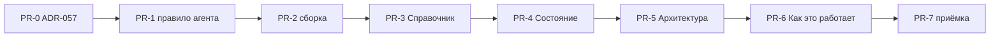

# moex-data-model: недостающие главы docs/user

## Что показала сверка

Пункты ревью вне раздела «Чего по плану ещё нет» в основном уже сделаны:
- `draft: true` против `verified_at`;
- видимая глава «Что ещё не рассказано» (её строит [user_docs.py](apps/viewer/src/moex_publication_viewer/user_docs.py) из `not_covered`);
- в «См. также» печатается имя термина, а не его `id`;
- предупреждение, когда ADR упомянут, но не лежит в `sources`;
- причины в [toc.yaml](docs/user/toc.yaml) говорят о продукте, а не о номере PR;
- в глоссарии появились карточки `invariant-code`, `negative-test`, `external-profile`, `operational-store`;
- README перечисляет все шаги проверки.

Не сделано три вещи.

1. Нет глав «Архитектура», «Как это работает», «Состояние» и «Справочник», и нет механизма страниц, которые собираются из репозитория. Сейчас так собирается только список отложенного.
2. В `not_covered` лежат 13 Accepted ADR: 004, 007, 008, 009, 015, 016, 019, 022, 030, 043, 044, 050, 053.
3. В ADR-057 остались три проблемы:
   - в D2 по-прежнему противоречие: термин «объясняют своими словами» и одновременно «не определяют заново»;
   - D8 обещает журнал, а журнал решено не заводить;
   - [user-docs.mdc](.cursor/rules/user-docs.mdc) повторяет обещание журнала.

Подводный камень: если страница статусов перечислит все ADR, проверка покрытия будет проходить всегда. Поэтому собранные из репозитория страницы в проверку покрытия не входят.

## Решения

- **Собираемые страницы.** В `toc.yaml` у страницы вместо `path` стоит `generated: <вид>`. Виды: `adr-status`, `cli-commands`, `make-targets`, `check-steps`. Шапки, `draft` и `sources` у таких страниц нет: факты берутся прямо из файлов.
- **Источники фактов:**
  - статусы — шапки `docs/adr/ADR-*.md`;
  - команды — разбор кода (AST) вызовов `add_parser` в [apps/cli/src/moex_model_cli/__main__.py](apps/cli/src/moex_model_cli/__main__.py) и [apps/viewer/src/moex_publication_viewer/cli.py](apps/viewer/src/moex_publication_viewer/cli.py), включая вложенные `lock update`, `source sync`, `selection validate`;
  - цели — [Makefile](Makefile);
  - шаги — `STEP_IDS` в [scripts/check_all.py](scripts/check_all.py).
- **Русские описания** лежат в `docs/user/90-reference/descriptions.yaml`. Файл разбит на группы `moex-model`, `moex-publication-viewer`, `make`, `check_all`, у каждой записи одна фраза. Сборка падает в трёх случаях: у команды нет фразы, фраза осталась у удалённой команды, фраза пустая. У самого файла `draft: true` или `verified_at`, контракт тот же, что у страницы.
- **Журнала нет.** История живёт в git, статусы ADR собираются автоматически. Обещание журнала убрать из ADR-057 D8 и из правила агента.
- Если HTML не совпадает со свежей сборкой, проверка падает. Это уже есть, поэтому смена статуса ADR, новая цель Makefile или новая команда сразу требуют пересборки `index.html`.
- **Просмотрщик не расширяем.** Если `render_markdown` не рисует mermaid, общая схема пишется нумерованным путём в тексте.

## Серия PR

Ветка на каждый PR. Начинаем после слияния `docs/user-docs-pr4-agents`.

**PR-0. Только [ADR-057](docs/adr/ADR-057-user-documentation.md).**
- D2: одна фраза вместо противоречия. На странице сказано, зачем термин нужен здесь, и стоит ссылка `glossary:`. Определение живёт только в карточке.
- D3: добавить `90-reference/descriptions.yaml`.
- D5: записи `generated:` и список видов.
- D8: убрать журнал. Добавить ошибки про описания. Записать, что собираемые страницы и страница отложенного покрытием ADR не считаются.
- D9: дописать таблицу этой серии.
- Статус остаётся Proposed.

**PR-1. Процесс.**
- [user-docs.mdc](.cursor/rules/user-docs.mdc): убрать строку про журнал; добавить обязанность: новая команда, цель Makefile или шаг проверки означают строку в `descriptions.yaml` в том же PR; формулировка D2.
- [AGENTS.md](AGENTS.md) трогать, только если ссылки поменялись.

**PR-2. Сборка без нового текста.**
- Новый модуль `apps/viewer/src/moex_publication_viewer/user_docs_generated.py`: генераторы и разбор описаний.
- В `user_docs.py`: ветка `generated:` в `compile_user_docs_module` и `_collect_page_records`, исключение из проверки покрытия, ошибки про описания в `check_user_docs`.
- Тесты в [apps/viewer/tests/test_user_docs.py](apps/viewer/tests/test_user_docs.py) на временном репозитории: каждый вид страницы, недостающее и лишнее описание, то, что собираемая страница покрытие не даёт.
- `index.html` в этом PR не меняется.

**PR-3. Глава «Справочник» (`90-reference/`).**
- Страницы «Команды moex-model», «Команды просмотра», «Цели Makefile» (с пометкой, входит ли цель в `make check`) и «Шаги общей проверки» — все собираются.
- `descriptions.yaml` с `draft: true`.
- Ручная страница «Адреса и префиксы» по ADR-030. Запись ADR-030 убрать из `not_covered`.
- Ручная страница «Нормативные документы»: файлы `docs/architecture/` со статусом и ролью.

**PR-4. Глава «Состояние» (`40-status/`).**
- Собираемая страница «Статусы решений»: номер, название, статус и сводка Accepted / Proposed.
- Ручная страница «Известные расхождения». При написании каждое расхождение перепроверить. Кандидаты:
  - [linkml_architecture.md](docs/architecture/linkml_architecture.md), строка 691, называет все ADR Proposed;
  - у [MODELING_ARCHITECTURE.md](docs/architecture/MODELING_ARCHITECTURE.md) одновременно `status: Proposed` и `normative: true`, а README зовёт его нормативным;
  - ADR-057 в статусе Proposed, хотя на него опираются проверка и правило;
  - единственная инструкция по ADR-045, [adding-an-invariant.md](docs/guides/adding-an-invariant.md), в статусе Proposed;
  - ADR-003 в статусе Proposed, хотя рядом уже лежат SQLite и compose для PostgreSQL.
- У каждого пункта указать, кто прав по иерархии ADR-057 D1. Сами файлы здесь не правим: это отдельные PR.

**PR-5. Глава «Архитектура» (`20-architecture/`).**
- «Общая схема»: путь YAML, проверка, `generated/`, HTML.
- «Приложения»: `cli`, `viewer`, `api`, `web`, `drawdb`; что работает и что вне `make check` (`api-check`, `web-check`, `drawdb-up`). Закрывает ADR-004, 005 и 007.
- «Пакеты кода»: 13 каталогов `packages/` по группам, источник — их README. Закрывает ADR-008.
- «Как устроены схемы DAMS»: файлы `schemas/`, примеси (ADR-044), реестр переходных меток (ADR-043), равенство владельца (ADR-050), метаданные утверждения (ADR-053).
- «Публикация и просмотр»: `publish.yaml`, профили и виды разделов, наследование контракта, оформление. Закрывает ADR-015, 016 и 019.
- Закрытые записи убрать из `not_covered`. Новые слова — в [glossary.yaml](docs/user/glossary.yaml) в том же PR.

**PR-6. Глава «Как это работает» (`30-howto/`).**
- «Изменить модель и проверить»: `check_all`, `--only`, что делать при падении `compare-golden`, `lock update`.
- «Добавить спецификацию или реализацию»: опись и фиксация, `publish.yaml`.
- «Собрать просмотр»: `make viewer`, `viewer-serve`, `user-docs`.
- «Добавить инвариант»: ADR-045 и матрица; инструкция-источник в статусе Proposed, это оговорить.
- «Импорт из таблицы»: ADR-022, [solution-xlsx-import.md](docs/dev/solution-xlsx-import.md), `import-solution`.
- «Черновой импорт схемы»: ADR-009, `moex-model import`.
- «Серии PR»: правило [multi-pr-series.mdc](.cursor/rules/multi-pr-series.mdc).
- Цель: `not_covered` пуст. Если что-то осталось, у записи честная причина.

**PR-7. Подчистка и приёмка.**
- [how-to-read.md](docs/user/00-start/how-to-read.md): убрать фразу «глав ещё нет», описать новые главы.
- [repo-map.md](docs/user/00-start/repo-map.md): убрать «отдельной главы ещё нет» и сослаться на «Пакеты кода».
- На всех страницах убрать хвосты из ссылок на ADR длиннее 2–3 штук.
- Владельцу передать список страниц с `draft: true` для сверки. Предложить перевести ADR-057 в Accepted. Статус меняет человек, агент сам не ставит ни его, ни `verified_at`.

## Проверка на каждой ветке

- PR-0 и PR-1: `python scripts/check_all.py --only user-docs` (предупреждения о свежести допустимы).
- PR-2: `pytest apps/viewer/tests -q` и полный `python scripts/check_all.py`.
- PR-3…PR-7: `make user-docs`, закоммитить `docs/user/index.html`, затем `python scripts/check_all.py --only user-docs`. Открыть `index.html` и проверить, что глава видна, а список отложенного сократился.
