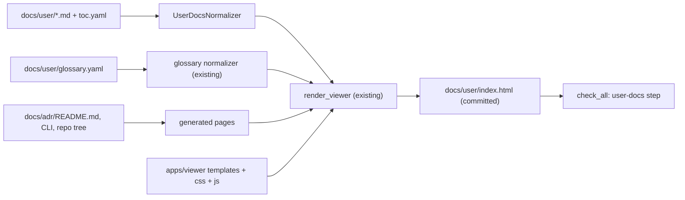

# moex-data-model: пользовательская документация (docs/user)

## Оценка идеи

Идея правильная и закрывает реальную дыру. Сейчас картину «что такое продукт» приходится собирать из шести мест:
- `MODELING_ARCHITECTURE.md` — единственный нормативный документ, но он всё ещё в статусе Proposed 0.2;
- 56 ADR (`docs/adr/README.md`);
- `constraint-matrix.md`;
- `IMPLEMENTATION_PLAN.md`;
- 50 файлов в `docs/migration`;
- около 25 файлов в `.cursor/plans`.

Часть этих документов уже устарела. Например, корневой `README.md` пишет «ADR-001–012», хотя ADR уже 56, а `linkml_architecture.md` называет все ADR «Proposed», хотя 47 из них Accepted.

Главный риск — сделать седьмой источник, который устареет быстрее остальных. Защита состоит из трёх решений, они заложены в план:
1. **Иерархия истины.** `docs/user` описывает текущее состояние и не вводит новых норм. Каждое утверждение ссылается на источник: ADR, код или схему. Если документы расходятся, прав нормативный документ, а пользовательская страница исправляется.
2. **Генерировать всё, что можно вывести из репозитория.** Таблица статусов ADR, карта папок, список команд CLI и make строятся при сборке, а не пишутся руками.
3. **Механические проверки в `check_all`.** Проверяются ссылки, источники, термины глоссария, покрытие Accepted ADR и совпадение HTML с исходниками.

## Правило языка

Обязательное правило для каждой страницы и для каждой карточки глоссария. Оно входит в ADR-057 и в `.cursor/rules/user-docs.mdc`.

- **Никакого жаргона.** Не пишем «envelope», «slice», «provider», «constraint matrix», «conformance», «modular monolith» и другие внутренние слова так, будто читатель их уже знает. Сначала обычное русское объяснение, имя из репозитория — только если без него нельзя найти место в коде, и сразу с пояснением.
- **Минимум непонятных терминов.** На странице оставляем только термины, без которых мысль не собрать. Каждый такой термин при первом упоминании объясняется своими словами и ссылается на глоссарий. Термин, который встретился один раз и никуда не ведёт, выбрасываем.
- **Понятность важнее точности формулировки.** Предложение должно быть понятно архитектору, который открыл репозиторий впервые. Если фразу приходится перечитывать, её переписываем, а не дополняем оговоркой.
- **Грамотность.** Правильный русский язык, законченные предложения, без кальки с английского и без обрубленных списков вместо текста.
- **Простота.** Одна страница — один экран. На странице отвечаем на четыре вопроса: что это, зачем, где лежит, что сейчас работает. Подробности не пересказываем, а даём ссылку на ADR или код.
- **Глоссарий — единственное место, где термин определяется.** В тексте страницы термин не определяется заново и не получает второй смысл.

## Как устроена сборка



Что переиспользуем:
- [`render_viewer`](apps/viewer/src/moex_publication_viewer/renderers/html_renderer.py), `assemble_css` и `assemble_js` из [`assets.py`](apps/viewer/src/moex_publication_viewer/assets.py) — без изменений.
- `catalog=None`. При пустом каталоге `viewer.js` (строка 1940) сам строит дерево из модулей, так что `architecture-catalog.yaml` не нужен.
- `split_frontmatter`, `render_markdown` и логику `_page_item` из [`package_docs.py`](apps/viewer/src/moex_publication_viewer/package_docs.py).
- Существующий рендерер `type: glossary`, поиск и hash-ссылки `#module=…&section=…&item=…`.

Что добавляем:
- Манифест `docs/user/user-docs.yaml`. Имя намеренно не `publish.yaml`: так основной viewer его не подхватит при поиске манифестов, и на него не распространяется ProfileSpec из ADR-016.
- `apps/viewer/src/moex_publication_viewer/user_docs.py`:
  - `UserDocsNormalizer` читает `docs/user/toc.yaml` с вложенными главами и строит дерево `PublicationItem`;
  - `build_user_docs(root, dist)` собирает только этот манифест.
- Подкоманда `build-user-docs` в [`cli.py`](apps/viewer/src/moex_publication_viewer/cli.py) и цель `make user-docs`.
- Ссылки на термины в markdown: `[топология](glossary:topology-ownership)`. При рендеринге они превращаются в hash-ссылку на карточку термина, а несуществующий термин даёт ошибку сборки.
- Детерминированная сборка (без временных меток), чтобы проверка совпадения HTML с исходниками была надёжной.

## Структура исходников

```text
docs/user/
  index.html            # собранный HTML (коммитится)
  user-docs.yaml        # манифест: модуль, разделы, заголовок
  toc.yaml              # дерево глав и страниц
  glossary.yaml         # термины: id, term, short, explanation, see_also, sources
  00-start/  10-concepts/  20-architecture/  30-howto/  40-status/  90-reference/
```

Frontmatter каждой страницы:

```yaml
---
id: three-roles
sources: [docs/architecture/MODELING_ARCHITECTURE.md, docs/adr/ADR-016-publication-section-kinds-and-profiles.md]
verified_at: 2026-11-02
---
```

## Предлагаемое дерево разделов

1. **Начало**
   - Что такое продукт: назначение, для кого, что умеет и чего не умеет.
   - Как читать документацию: иерархия истины, статусы Accepted, Proposed и Draft.
   - Карта репозитория (генерируется): папка, зачем она нужна, когда её трогать.
2. **Ключевые идеи**
   - Три роли: стандарт, спецификация и реализация (LinkML, DAMS 0.1, mdm).
   - Модельный пакет и репозиторий: `ModelPackage`, `MOEXModelRepository`, manifest и lock (ADR-047, ADR-054).
   - Слои модели: CDM, LDM, PDM и `TechnicalAsset` (ADR-026, ADR-031–033, ADR-038–041).
   - Что является источником истины: Git и YAML, а `generated/`, viewer, DBML и drawDB — производные (ADR-002, ADR-006, ADR-011).
   - Топология и владение: Clinkr/EAM против привязок DAMS (ADR-048, ADR-055).
   - Governance: назначения и эффективное представление (ADR-023, ADR-049).
   - Определения и их наследование (ADR-025).
   - Требования и проверка соответствия: каталог требований, constraint matrix, уровни L1–L3 (ADR-013, ADR-045, ADR-056).
   - Идентичность и версии: Version, Revision, Distribution, `integrity_digest` (ADR-042, ADR-052).
   - Внешние онтологии и FIBO (ADR-014, ADR-017, ADR-018, ADR-020).
3. **Архитектура**
   - Общая схема (mermaid).
   - Приложения: viewer, cli, api, web, drawdb.
   - Пакеты: kernel, providers, publication и другие.
   - Путь данных от YAML до HTML: validate, compile, generated, publish.
   - Паттерны: modular monolith, provider, generated-from, профили публикаций.
4. **Как это работает** (сценарии)
   - Изменить модель и проверить её (`check_all`).
   - Добавить спецификацию или реализацию.
   - Опубликовать в viewer.
   - Добавить инвариант.
   - Как устроены серии PR.
5. **Состояние сейчас**
   - Статусы ADR и возможностей (генерируется из `docs/adr/README.md`).
   - Что нового: короткий журнал по датам.
   - Известные расхождения документов.
6. **Глоссарий** — около 40 терминов. Стартовый список уже собран из ADR и архитектурных документов.
7. **Справочник** — команды CLI и make (генерируется), ссылки на нормативные документы.

## Как поддерживать актуальность

- Скрипт `scripts/check_user_docs.py` и шаг `user-docs` в [`scripts/check_all.py`](scripts/check_all.py). Скрипт проверяет:
  - что существуют все пути в `sources`;
  - что разрешаются относительные ссылки и ссылки `glossary:`;
  - что каждый Accepted ADR упомянут хотя бы на одной странице или явно перечислен в `toc.yaml: not_covered` с причиной;
  - что `docs/user/index.html` совпадает со свежей сборкой.
- Предупреждение, а не ошибка, если файл из `sources` менялся в git после `verified_at`. Так видно, какие страницы пора перепроверить.
- Cursor-правило `.cursor/rules/user-docs.mdc`. Новый ADR, смена статуса ADR, изменение раскладки `apps/`, `packages/` или `model-assets/`, а также изменение команд CLI требуют в том же PR обновить страницу и запись в «Что нового». Правило языка из ADR-057 — часть этого правила: страница с жаргоном и необъяснёнными терминами не проходит.
- Указатель для агентов: короткий корневой `AGENTS.md` и строка в `README.md` со ссылкой на `docs/user/00-start/`.

## Серия PR (по правилу multi-pr-series)

- **PR-0 (только документы):** ADR-057 «Пользовательская документация как описание текущего состояния». В нём иерархия истины, правило языка (без жаргона, минимум терминов, понятность, грамотность, простота), контракт frontmatter и `toc.yaml`, политика актуальности. Схемы, код и `generated/` не трогаем.
- **PR-1 (инструменты):** `user_docs.py`, команда CLI, `make user-docs`, `check_user_docs.py`, шаг в `check_all` и тесты в `apps/viewer/tests`. Плюс минимальный каркас: `toc.yaml`, одна страница и три термина, чтобы проверить сборку и проверки.
- **PR-2 (наполнение, часть 1):** «Начало», «Ключевые идеи», полный глоссарий.
- **PR-3 (наполнение, часть 2):** «Архитектура», «Как это работает», «Состояние сейчас», «Справочник», а также генерируемые страницы.
- **PR-4 (процесс):** Cursor-правило, `AGENTS.md`, правка `README.md` (в том числе устаревшего «ADR-001–012»).

Черновики страниц может готовить агент по ADR и коду. Проверка фактов остаётся за владельцем: поле `verified_at` ставится только после такой проверки.
